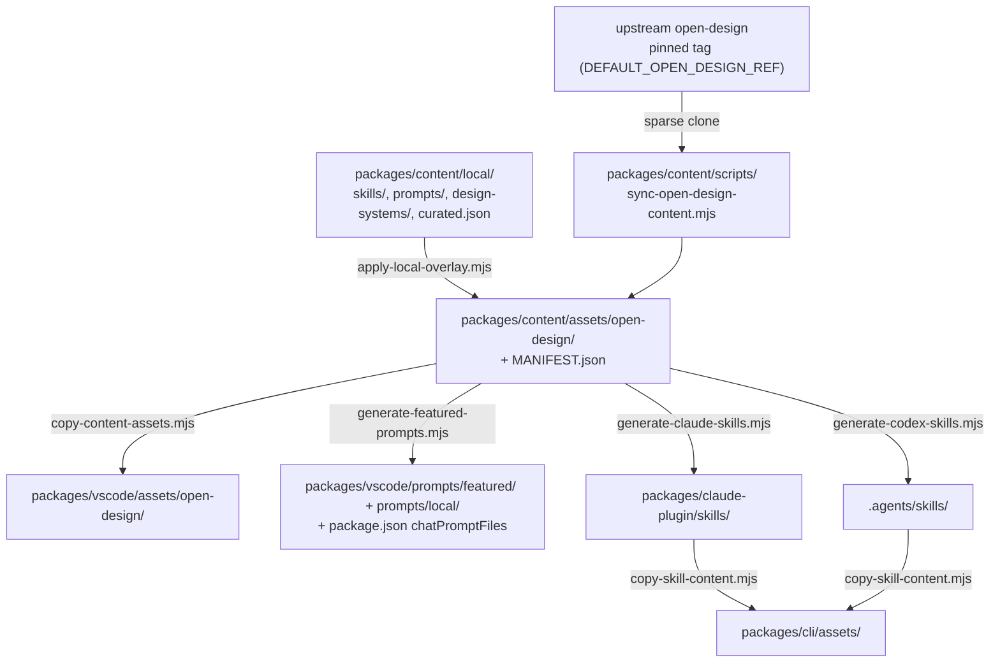

# Content sync

The skills, design templates, design systems, craft rules and examples come from upstream [Open Design](https://github.com/nexu-io/open-design) and are **vendored into this repo** (committed, about 15 MB) rather than fetched at runtime. This page covers how that content gets in, how our own additions sit on top, and what keeps every copy consistent.

## The pipeline



Run the whole pipeline with:

```bash
npm run sync-content
```

## Upstream pin

`sync-open-design-content.mjs` shallow-clones the **official repo at a tagged release** (`DEFAULT_OPEN_DESIGN_REF`, e.g. `open-design-v0.22.2`), sparse-checking out only `skills`, `design-templates`, `design-systems`, `craft` and `plugins/_official/examples`. For each design system only `DESIGN.md`, `manifest.json` and `tokens.css` are copied; the rest of upstream's package (pre-rendered kits, `components.html`, `design-tokens.json`…) isn't, because the preview renders from `tokens.css` at runtime. Examples over 2 MB are skipped. The result and its source commit are recorded in `assets/open-design/MANIFEST.json`.

To update: check the [upstream tags](https://github.com/nexu-io/open-design/tags), bump `DEFAULT_OPEN_DESIGN_REF`, run `npm run sync-content`, and review the diff. For testing against a fork, set `OPEN_DESIGN_SRC` (a local checkout), `OPEN_DESIGN_REPO` or `OPEN_DESIGN_REF`. See [the variables](../reference/settings-and-env.md#contributor-only-variables).

## Local overlay

Files under `packages/content/assets/open-design/` are never hand-edited. This project's own content lives in `packages/content/local/` and is layered on top by `apply-local-overlay.mjs`, which runs at the end of every sync or alone via `npm run apply-overlay --workspace=@feimacode/open-design-agent-kit-content`:

- `local/skills/<id>/SKILL.md`: extension-authored skills (e.g. `social-youtube-thumbnail`). An id that collides with an upstream skill or template fails the sync.
- `local/prompts/<name>.md`: host-agnostic prompts (e.g. `social-post.md`), rendered per host by the generators.
- `local/design-systems/<id>/tokens.override.css` and `DESIGN.sections.md`: generated fixes for an upstream design system whose `DESIGN.md` and `tokens.css` describe different looks. The first is applied on top of the vendored `tokens.css` when tokens resolve; the second replaces whole sections (Color, Typography, Spacing & Grid) of the loaded `DESIGN.md`. Neither vendored file is touched. The id must exist upstream and the folder may hold only these two files; see `local/README.md`.
- `local/design-system-sources.json`: which side is the truth, per system, for colour and for type. See [Design system consistency](#design-system-consistency).
- `local/curated.json`: extra entries that get a curated command even though upstream doesn't flag them. An unknown id fails generation.

See [Adding a skill or prompt](adding-a-skill-or-prompt.md).

## Design system consistency

Most of upstream's template `DESIGN.md` files (the ones whose colour bullets end "Token from style foundations") name a different primary colour and font from their own `tokens.css`, so a brief or a Claude Design export would carry two brands. The audit compares the template's Primary, Success, Warning, Danger, Background, Surface and Text colours, its font families, and its type and spacing scales with the resolved tokens:

```bash
npm run audit-design-systems --workspace=@feimacode/open-design-agent-kit-content              # side-by-side table
npm run audit-design-systems --workspace=@feimacode/open-design-agent-kit-content -- --suggest  # rows for undecided systems
npm run audit-design-systems --workspace=@feimacode/open-design-agent-kit-content -- --write    # regenerate the overlays
npm run apply-overlay --workspace=@feimacode/open-design-agent-kit-content
```

Each system is `consistent`, `tokens-placeholder`, `design-placeholder` or `conflict`. A suggestion makes the placeholder side lose (`#2563eb`, `#3b82f6`, or Inter alone against a named family) and otherwise keeps `tokens`, which is what renders today. Review the table, change `color` or `type` where the system's name and summary describe the other side (`lingo` is the playful green Nunito of its `DESIGN.md`), write a reason, and delete `"suggested"`. A `"design"` decision generates a `tokens.override.css`; a `"tokens"` one generates a `DESIGN.sections.md`. Light/dark polarity, the eight-step type scale and spacing always follow `tokens.css`, so both files end up agreeing.

When a sync changes a system's resolved tokens, list it in the release notes: designs made in it will look different.

## Curation

An entry gets a one-step command when upstream frontmatter has `featured`, `recommended` or `od.default_for`, or when it's listed in `local/curated.json`. That rule lives once in `packages/content/scripts/curatedEntries.mjs` and drives the VS Code prompt files, the Claude skills and the Codex skills.

## Drift checks (`npm run lint`)

| Check | Fails when |
|---|---|
| `packages/content/scripts/check-content-sync.mjs` | The pinned ref and `MANIFEST.json` disagree, an overlay file is missing or stale in `assets/`, a vendored `tokens.css` is missing, a token override repeats a value upstream now has (delete it), or a template design system whose `DESIGN.md` and `tokens.css` disagree has no confirmed decision or a stale generated overlay. |
| `packages/vscode/scripts/check-content-mirror.mjs` | The VS Code mirror differs from `packages/content`. |
| `packages/claude-plugin/scripts/check-skills-sync.mjs` | Generated Claude skills don't match the curated set and local prompts. |
| `packages/codex/scripts/check-codex-skills-sync.mjs` | Generated Codex skills don't match, or a local-prompt skill gained an explicit-only policy. |
| `packages/cli/scripts/check-cli-assets-sync.mjs` | The CLI's copied skills are stale. |
| `scripts/check-docs.mjs` | A tool, setting, env var, command or CLI flag is undocumented, or a docs link is broken. |

Every failure message names the command that fixes it, usually `npm run sync-content`. Don't hand-edit generated output: `prompts/featured/`, `prompts/local/`, `packages/claude-plugin/skills/` (except `skills/open-design/`) and `.agents/skills/`.
